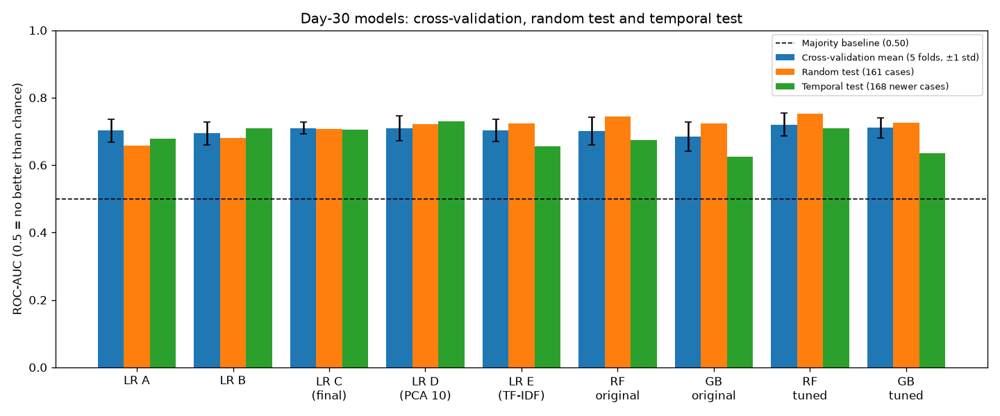

# GA Data Science Capstone: Early Warning for Long Administrative Cases

Can information recorded during the first 30 days help identify administrative cases likely to have a longer recorded
activity span?

## The problem

In a Dutch municipality's building-permit records, some cases have recorded activity spans of only a few weeks and others
of many months; spotting the long ones early could help staff look at them sooner. The **recorded activity span** is the
time from the first to the last recorded event of a case: it is not a verified completion date and not a legal deadline.
A case counts as "long" when this span is more than 63 days, the median recorded activity span among the cases with a
recorded end date. The question was motivated by SPAR, where it could become a future research direction, but this
project uses only historical public Dutch municipal data, **not SPAR data**, and it does not claim causes or offer a tool
ready for real use.

## Key result

Using the activities recorded in the first 30 days, the final model (**Logistic Regression C**) separates long cases from
shorter ones clearly better than the baseline. Its **ROC-AUC is 0.710 in cross-validation, 0.708 on a random test set and
0.705 on newer cases** (a temporal test made only of later cases), compared with **0.500 for the baseline** that
predicts "long" for every case. ROC-AUC measures how well a model ranks long cases above shorter ones: 0.5 is no better
than chance and 1.0 is perfect. On the random test set the model found 73 of the 95 long cases (recall 0.768), and 73 of
the 100 cases it flagged were really long (precision 0.730).



A tuned Random Forest had the highest cross-validation score (0.720), and a Logistic Regression on 10 PCA components had
the highest score on newer cases (0.729). Logistic Regression C was chosen because it was close behind in
cross-validation and each of its features can be explained. The choice used a "one-standard-error" rule of thumb (keep
models whose cross-validation score is within one standard error of the best, threshold 0.705, then take the simplest).
This rule was written down after the exploratory experiments and does not prove that the models are statistically
equal. The temporal test is a historical check of how the model holds up on later cases, not an untouched independent
validation: its cases had been used earlier in the research. The signal is modest: on newer cases the model still
misses half of the long cases.

## The data

- **Source:** BPI Challenge 2015 Municipality 1, by Boudewijn van Dongen (Eindhoven University of Technology), published
  on 4TU.ResearchData: <https://doi.org/10.4121/uuid:a0addfda-2044-4541-a450-fdcc9fe16d17>
- **Size:** one event-log file, `BPIC15_1.xes` (41,227,060 bytes), with 52,217 recorded events for 1,199 applications
  and 29 columns.
- **Collection period:** the source describes roughly four years of data; the events in the file run from October 2010
  to July 2015.
- **Terms:** 4TU General Terms of Use; the dataset must be cited. This is not a Creative Commons licence, and the code
  license of this repository does not apply to the data.
- **In plain words:** a log of the steps (activities) recorded for each building-permit application at one Dutch
  municipality, with dates and anonymous resource numbers instead of employee names.

The original file is stored with Git LFS and never edited. How to obtain and check it is explained in
[data/README.md](data/README.md).

## How to navigate this repo

Start here, then read the [EDA notebook](notebooks/01_eda.ipynb), followed by the
[modelling notebook](notebooks/02_modelling.ipynb). Data instructions are in [data/](data/README.md); figures and result
tables are in [docs/](docs/README.md).

The project was developed in 21 earlier notebooks (linear regression, tree models, day-14 and day-30 early warning,
temporal validation and follow-up experiments). Their questions, results and links to the original versions are
summarised in [docs/research_history.md](docs/research_history.md).

## How to reproduce

You need Python 3.12 or newer, Git and **Git LFS** (the original data file is stored with Git LFS; see
[data/README.md](data/README.md)). The final submission branch is `tidy_project`.

**What has been tested:** on Windows 11 with Python 3.14.7, a new environment installed from `requirements.txt` without
conflicts, `jupyter notebook` started, and both notebooks ran from start to finish in fresh kernels (with
`jupyter nbconvert --to notebook --execute`), twice, with identical results. The pinned versions also resolve for Linux
with Python 3.12 and 3.13 (checked with pip only, not run). They do not install on Python 3.11 or older.

```bash
git lfs install
git clone --branch tidy_project https://github.com/cikicali369-glitch/GA-Data-Science-Capstone-Ali.git
cd GA-Data-Science-Capstone-Ali
git lfs pull
python -m pip install -r requirements.txt
jupyter notebook
```

Run `notebooks/01_eda.ipynb` first, then `notebooks/02_modelling.ipynb`, each from a fresh session. The EDA notebook
creates `data/processed/bpic15_events.csv.gz`, which the modelling notebook loads; this file is not stored in the
repository, so 01 must be run before 02.

In Colab, first clone this repository, enter its folder, and install requirements as shown above (use `!git lfs install`,
`!git clone`, `%cd`, `!git lfs pull` and `%pip install` in a code cell). Obtain data as explained in
[data/README.md](data/README.md). Opening a badge alone does not copy the repository or its data. Each Colab session
starts empty, so in the session for the modelling notebook, run the EDA notebook first (for example with
`!jupyter nbconvert --to notebook --execute notebooks/01_eda.ipynb`) to create the processed file. Colab comes with
other versions of some packages already installed, so it may ask you to restart the session after `%pip install`. The
Colab route has **not been tested**.

[](https://colab.research.google.com/github/cikicali369-glitch/GA-Data-Science-Capstone-Ali/blob/tidy_project/notebooks/01_eda.ipynb)
[](https://colab.research.google.com/github/cikicali369-glitch/GA-Data-Science-Capstone-Ali/blob/tidy_project/notebooks/02_modelling.ipynb)

## Repository structure

Files and folders stored in Git:

```text
README.md                  Public project story
LICENSE                    Code license; data has separate terms
requirements.txt           Packages and verified versions
.gitignore                 Files to keep out of Git
.gitattributes             Tells Git LFS to store the large original data file
data/
  README.md                Acquisition and file-size policy
  data_dictionary.csv      Meaning of all 29 columns
  raw/                     Untouched original (BPIC15_1.xes, Git LFS) and provenance
  processed/README.md      Description of the generated data file
notebooks/
  01_eda.ipynb             Explore, document decisions, export
  02_modelling.ipynb       Compare methods and explain results
docs/
  README.md                List of figures and result tables
  research_history.md      How the research developed (21 earlier notebooks)
  figures/                 Figures saved by the two notebooks
  results/                 Result tables (CSV)
```

Created locally when the notebooks run (git-ignored, not in the repository):

```text
data/processed/bpic15_events.csv.gz    Event table exported by 01_eda.ipynb, loaded by 02_modelling.ipynb
models/logistic_regression_c.pkl       Saved final model from 02_modelling.ipynb
```

## Author & credits

- **Author:** Ali Čikić, General Assembly Data Science Bootcamp (capstone project).
- **Instructor:** the General Assembly instructor provided the project template and README structure used here.
- **Review:** Hank Butler gave review recommendations; the nine recommendations and how each was followed are listed in
  [docs/research_history.md](docs/research_history.md).
- **Data provider:** Boudewijn van Dongen, Eindhoven University of Technology, via 4TU.ResearchData (BPI Challenge 2015
  Municipality 1, <https://doi.org/10.4121/uuid:a0addfda-2044-4541-a450-fdcc9fe16d17>).
- **Software:** pandas, NumPy, matplotlib, scikit-learn and Jupyter; PM4Py is used to read the event log (PM4Py is
  licensed under AGPL-3.0). No pretrained models or code from other projects are reused.

## License

The code and documentation in this repository are released under the [MIT License](LICENSE), Copyright (c) 2026 Ali
Čikić, General Assembly Data Science Bootcamp.

The MIT License does not cover the data. The dataset is published under the 4TU General Terms of Use and must be cited
as: van Dongen, Boudewijn (2015): BPI Challenge 2015 Municipality 1. Version 1. 4TU.ResearchData. dataset.
<https://doi.org/10.4121/uuid:a0addfda-2044-4541-a450-fdcc9fe16d17>. The dataset's [General Terms of Use](https://doi.org/10.4121/resource:terms_of_use), Article 4,
allow non-commercial reuse and redistribution with source attribution. Any subsequent redistribution must retain
the acknowledgment of Boudewijn van Dongen and the dataset citation above. Article 3 requires publication details
to be provided to 4TU.ResearchData. The processed file is generated locally and kept out of Git. No pretrained models are used,
and the saved model file is not published. Third-party packages keep their own licenses.
